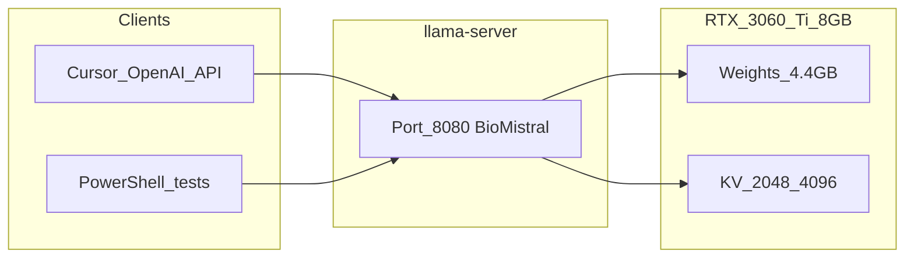

# Чек-лист: BioMistral-7B-Instruct Q4_K_M на i5-11500 + 32GB + RTX 3060 Ti 8GB (llama.cpp)

## Отличия от [Qwen3.6 чек-листа](qwen3.6-llama-cpp-checklist.md)

| | Qwen3.6 35B-A3B | BioMistral 7B Q4_K_M |
| --- | --- | --- |
| VRAM | 12 GB + гибрид RAM, `n-cpu-moe` | **8 GB, весь модель на GPU** |
| Контекст | 32k+ | **2048 native** (обучение); 4096 — осторожно |
| Серверы | Think + Code (два режима) | **один** медицинский профиль |
| Скорость (ориентир) | ~8–18 tok/s | **~55–75 tok/s** |
| Назначение | код, reasoning, vision | **мед. тексты, MCQ, abstract (исследования)** |

---

## Disclaimer (обязательно прочитать)

BioMistral предназначен **только для исследований**. Авторы [предупреждают](https://huggingface.co/BioMistral/BioMistral-7B): модель **не** проходила клиническую валидацию, возможны bias и галлюцинации. **Не использовать** для диагностики, назначения лечения или решений в реальной медицине.

---

## Модель и файл

**«BioMistral-7B-Instruct Q4_K_M»** в экосистеме Hugging Face — это **[BioMistral/BioMistral-7B](https://huggingface.co/BioMistral/BioMistral-7B)** (база **Mistral-7B-Instruct-v0.1**, домен PubMed Central), квант **Q4_K_M** (~**4.37 GB**).

- Официальный GGUF: [BioMistral/BioMistral-7B-GGUF](https://huggingface.co/BioMistral/BioMistral-7B-GGUF)
- Sequence length по model card: **2048** токенов



---

## Фаза 0 — Подготовка Windows, пошагово

> Если **llama.cpp уже собран** по Qwen-чек-листу на этом ПК — достаточно **0.1, 0.2, 0.7** и переходите к фазе 2.

### 0.1 Каталоги

```powershell
New-Item -ItemType Directory -Force -Path "D:\AI\llama.cpp", "D:\Models\llama", "D:\AI\scripts"
```

### 0.2 Драйвер NVIDIA

1. [nvidia.com/drivers](https://www.nvidia.com/drivers) → **RTX 3060 Ti** → Windows.
2. После установки:

```powershell
nvidia-smi
```

Ожидаете: **8192 MiB**, compute capability **8.6**.

### 0.3 CUDA Toolkit (только для сборки llama.cpp)

[CUDA 12.4 / 12.6](https://developer.nvidia.com/cuda-downloads) → проверка: `nvcc --version`.

### 0.4 Visual Studio 2022

Workload **Desktop development with C++**, MSVC v143, Windows SDK, CMake tools.

### 0.5 Python + Hugging Face CLI

```powershell
python -m pip install -U pip "huggingface_hub[cli]" hf-transfer
[Environment]::SetEnvironmentVariable("LLAMA_CACHE", "D:\Models\llama", "User")
[Environment]::SetEnvironmentVariable("HF_HUB_ENABLE_HF_TRANSFER", "1", "User")
```

### 0.6 Файл подкачки

Для 7B на GPU достаточно **32768–49152 MB** на SSD (Win+R → `sysdm.cpl` → виртуальная память).

### 0.7 Перед запуском

- Закрыть игры и тяжёлые GPU-приложения.
- Цель: **≥ 1.5 GB свободной VRAM** до старта (веса ~4.4 GB + KV + runtime ≈ **5.5–7.5 GB** при ctx 2048–4096).

```powershell
nvidia-smi -l 2
```

---

## Фаза 1 — Сборка llama.cpp (CUDA, sm_86)

В **x64 Native Tools Command Prompt for VS 2022**:

```cmd
cd /d D:\AI
git clone https://github.com/ggml-org/llama.cpp
cd llama.cpp
cmake -B build -DBUILD_SHARED_LIBS=OFF -DGGML_CUDA=ON -DCMAKE_BUILD_TYPE=Release -DCMAKE_CUDA_ARCHITECTURES=86
cmake --build build --config Release -j %NUMBER_OF_PROCESSORS% --target llama-server llama-cli
build\bin\Release\llama-server.exe --version
```

Альтернатива: [prebuilt CUDA binaries](https://github.com/ggerganov/llama.cpp/releases) для Windows.

---

## Фаза 2 — Загрузка BioMistral Q4_K_M

```powershell
$env:LLAMA_CACHE = "D:\Models\llama"
$dest = "$env:LLAMA_CACHE\BioMistral\BioMistral-7B-GGUF"
hf download BioMistral/BioMistral-7B-GGUF `
  --local-dir $dest `
  --include "*Q4_K_M*"
```

Проверка:

```powershell
Get-ChildItem $dest -Recurse -Filter "*Q4_K_M*.gguf" | Select-Object Name, @{N='GB';E={[math]::Round($_.Length/1GB,2)}}
```

Ожидаете **~4.2–4.4 GB** на диске.

Запас по качеству (если VRAM позволяет при ctx 2048): **Q5_K_M** (~5.1 GB). Альтернативная весовая сборка: [BioMistral-7B-DARE-GGUF](https://huggingface.co/BioMistral/BioMistral-7B-DARE-GGUF) (часто лучше на MCQ-бенчмарках).

---

## Фаза 3 — Конфиг под RTX 3060 Ti 8GB

### 3.0 Параметры

| Параметр | Значение | Зачем |
| --- | --- | --- |
| `n-gpu-layers` | `99` | Весь 7B на GPU |
| `ctx-size` | **`2048`** | Нативное окно BioMistral |
| `ctx-size` (опц.) | `4096` | Длинный abstract + вопрос; следить OOM |
| `parallel` | `1` | Cursor / один пользователь; `2` только при ctx 2048 |
| `threads` | `8`–`10` | i5-11500, 12 потоков |
| `--temp` | `0.1`–`0.3` | Меньше галлюцинаций в фактах |
| `--repeat-penalty` | `1.1` | Меньше повторов |

При нехватке VRAM на ctx 4096:

```text
--cache-type-k q8_0 --cache-type-v q8_0
```

### 3.1 `models.ini` (опционально)

`%USERPROFILE%\.config\llama.cpp\models.ini`:

```ini
[*]
no-mmap = true
sleep-idle-seconds = 600

[BioMistral/BioMistral-7B-GGUF:Q4_K_M]
alias = biomistral-7b-instruct
ctx-size = 2048
n-gpu-layers = 99
parallel = 1
```

### 3.2 `D:\AI\scripts\BioMistral-Common.ps1`

```powershell
$LLAMA_ROOT = "D:\AI\llama.cpp"
$script:SERVER = "$LLAMA_ROOT\build\bin\Release\llama-server.exe"
$env:LLAMA_CACHE = "D:\Models\llama"

$MODEL_DIR  = "$env:LLAMA_CACHE\BioMistral\BioMistral-7B-GGUF"
$MODEL_GGUF = (Get-ChildItem $MODEL_DIR -Filter "*Q4_K_M*.gguf" | Select-Object -First 1).FullName
if (-not $MODEL_GGUF) { throw "Q4_K_M GGUF not found in $MODEL_DIR" }

$script:COMMON = @(
  "--model", $MODEL_GGUF,
  "--host", "127.0.0.1",
  "--ctx-size", "2048",
  "--n-gpu-layers", "99",
  "--parallel", "1",
  "--threads", "10"
)
```

### 3.3 `Start-BioMistral-Med.ps1` (факты / MCQ)

```powershell
. "$PSScriptRoot\BioMistral-Common.ps1"
& $SERVER @COMMON `
  --port 8080 `
  --alias "biomistral-7b-instruct" `
  --temp 0.2 --top-p 0.9 --top-k 40 --min-p 0.05 `
  --repeat-penalty 1.1
```

### 3.4 `Start-BioMistral-Explain.ps1` (развёрнутые объяснения, учеба)

```powershell
. "$PSScriptRoot\BioMistral-Common.ps1"
& $SERVER @COMMON `
  --port 8080 `
  --alias "biomistral-7b-instruct" `
  --temp 0.5 --top-p 0.95 --top-k 50 --min-p 0.05 `
  --repeat-penalty 1.05
```

Запуск:

```powershell
Set-ExecutionPolicy -Scope CurrentUser RemoteSigned
D:\AI\scripts\Start-BioMistral-Med.ps1
```

**Шаблон Mistral Instruct** (для `llama-cli`; server обычно применяет chat template из GGUF):

```text
<s>[INST] Your question here [/INST]
```

### 3.5 Профили задач

| Сценарий | Скрипт | Промпт |
| --- | --- | --- |
| MCQ (USMLE-style) | Med, temp 0.2 | «Answer with letter A–D only, then 2-sentence rationale» |
| Разбор кейса (учеба) | Explain | Симптомы + анализы; «differential as hypotheses, not prescriptions» |
| Summary abstract | Med | Вставить abstract ≤ ~1500 tokens |
| Troubleshooting ПО/лаб. | Explain | Явно: не мед. совет пациенту |
| RAG по PDF/PubMed | Med | Контекст в `[INST]`, «answer only from context» |

**Язык:** модель сильнее на **английском** (и частично FR/DE/ES). Для русских запросов — просить **bilingual** или ответ на EN.

---

## Фаза 4 — Проверка

### 4.1 API

```powershell
Invoke-RestMethod -Uri "http://127.0.0.1:8080/v1/models"
```

### 4.2 Тест MCQ

```powershell
$body = @{
  model = "biomistral-7b-instruct"
  messages = @(@{
    role = "user"
    content = "Which organ produces insulin? A) Liver B) Pancreas C) Spleen D) Kidney. Answer with one letter then brief rationale."
  })
  max_tokens = 256
} | ConvertTo-Json -Depth 5

Invoke-RestMethod -Uri "http://127.0.0.1:8080/v1/chat/completions" `
  -Method Post -ContentType "application/json; charset=utf-8" -Body $body
```

Ожидаете **B** / Pancreas.

### 4.3 VRAM

При генерации: `nvidia-smi` → **~5–7 GB** used (ctx 2048).

---

## Фаза 5 — Cursor

1. Запустить **Start-BioMistral-Med.ps1** (порт **8080**).
2. Settings → Models → Override OpenAI Base URL: `http://127.0.0.1:8080/v1`
3. API Key: `sk-local`
4. Custom model: `biomistral-7b-instruct`

**Параллельно с Qwen:** Qwen на `:8002`, BioMistral на `:8080` — **оба могут работать** на 32 GB RAM (7B + 35B hybrid тяжело; если Qwen уже грузит RAM, BioMistral один).

---

## Фаза 6 — Траблшутинг

| Симптом | Действие |
| --- | --- |
| CUDA OOM | `ctx-size 2048`, `parallel 1`, закрыть GPU apps |
| Медленно (~5 tok/s) | Пересобрать с `GGML_CUDA=ON`; не CPU-only |
| Галлюцинации | ↓ temp, RAG-only prompts, EN prompts |
| Обрезанный ответ | Длинный prompt > 2048 → сократить контекст |
| Порт занят | `netstat -ano \| findstr 8080` |

---

## Фаза 7 — Опционально

- **Q5_K_M** — лучше качество, ctx 2048 на 8 GB обычно OK.
- **BioMistral-7B-DARE-GGUF** — тот же pipeline, другой `.gguf`.
- Бенчмарк: 100 токенов / секунды ≈ tok/s (ориентир **60+** на 3060 Ti).

---

## Источники

- [BioMistral/BioMistral-7B](https://huggingface.co/BioMistral/BioMistral-7B)
- [BioMistral/BioMistral-7B-GGUF](https://huggingface.co/BioMistral/BioMistral-7B-GGUF)
- [BioMistral paper (arXiv:2402.10373)](https://arxiv.org/abs/2402.10373)
- Prompt template: `<s>[INST] ... [/INST]` ([tensorblock GGUF card](https://huggingface.co/tensorblock/BioMistral-7B-GGUF))
