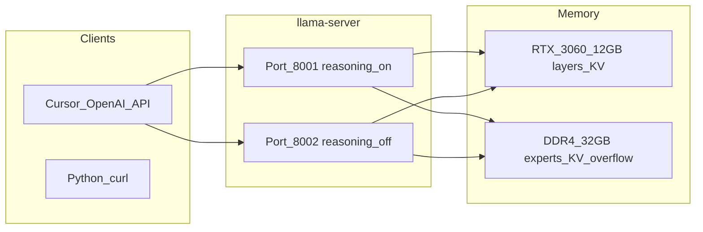

# Чек-лист: Qwen3.6 на i7-14700KF + 32GB + RTX 3060 12GB (llama.cpp)

Все команды ниже — **Windows PowerShell**. В штатном PSReadLine 2.0 многострочная вставка приходит **задом наперёд**: в консоли первой оказывается последняя строка блока, и `Join-Path` падает с `Path = NULL`. Пока модуль не обновлён, в консоль вставляется только **одна строка**.

Починить вставку (один раз, потом новое окно PowerShell):

```powershell
Install-Module PSReadLine -Scope CurrentUser -Force -AllowClobber
```

Проверка в новом окне: `(Get-Module PSReadLine).Version` — нужно **2.2** или новее. После этого многострочные блоки из этого файла вставляются как написаны.

Пути этой машины (уже так и лежит на диске):

| Что | Путь |
| --- | --- |
| Исходники и сборка | `G:\localAI\AI\llama.cpp` |
| Сервер | `G:\localAI\AI\llama.cpp\build\bin\Release\llama-server.exe` |
| Модели | `G:\localAI\Models\llama` |
| Скрипты запуска | `G:\localAI\AI\scripts` |
| CUDA Toolkit | `C:\Program Files\NVIDIA GPU Computing Toolkit\CUDA\v13.4` |

Visual Studio на этой машине — **18 2026** (MSVC 19.51). Для неё нужен **CUDA Toolkit 13.4**. CUDA 12.6 в каталоге `VC\v180\BuildCustomizations` файлов `CUDA *.props` не кладёт, конфигурация CMake на этом обрывается.

---

## Реалистичная цель железа

| Модель Qwen3.6 | На вашей конфигурации |
| --- | --- |
| **35B-A3B (MoE, официальная)** | **Основной выбор**: ~3B активных параметров на токен; веса Q4 ~23 GB суммарной памяти (RAM+VRAM), у вас **12 GB VRAM + ~24–28 GB свободной RAM** — помещается при гибриде и `n-cpu-moe`. |
| **27B (dense)** | Q4 ~**19 GB только на 4K контекста**. Полный GPU-only на 12 GB невозможен, offload даст ~3–8 tok/s. |
| **NVFP4** | Только Blackwell (RTX 50xx). На 3060 не используется. |

**Вывод:** для рассуждений, траблшутинга и разработки ставим `unsloth/Qwen3.6-35B-A3B-GGUF` квант **UD-Q4_K_XL** и **mmproj** для vision. Если не хватает VRAM под vision и длинный контекст — запасной квант **UD-Q3_K_XL** или **UD-IQ4_NL_XL**.

Ожидаемый UX (ориентир): **~8–18 tok/s** decode при частичном offload экспертов на CPU. Thinking-режим тратит сотни–тысячи скрытых токенов до ответа. Это нормальная работа, не зависание.



---

## Важно про RAM и два сервера

На **32 GB DDR4** один экземпляр Qwen3.6-35B-A3B (Q4 + KV + runtime) занимает **~23–28 GB RAM+VRAM** в гибриде. Два `llama-server` одновременно почти наверняка уходят в swap.

- По умолчанию работает один сервер. Смена режима = остановить процесс (Ctrl+C) и запустить другой скрипт.
- Два порта параллельно — только если после одного сервера в диспетчере задач свободно больше 14 GB RAM и второй стартует без swap.

---

## Запуск сервера, если сборка и модель уже на месте

`llama-server.exe` уже собран, GGUF уже скачан. Фазы 0–2 повторять не нужно. Если прошлый запуск ещё висит — Ctrl+C.

Команда ниже — **одна строка**. Её можно вставлять в текущий PowerShell даже со старым PSReadLine. Переносов внутри нет, переворачивать нечего.

```powershell
$env:Path = "C:\Program Files\NVIDIA GPU Computing Toolkit\CUDA\v13.4\bin\x64;" + $env:Path; $bin = "C:\Program Files\NVIDIA GPU Computing Toolkit\CUDA\v13.4\bin\x64"; if (-not (Test-Path "$bin\cudart64_13.dll")) { $bin = "C:\Program Files\NVIDIA GPU Computing Toolkit\CUDA\v13.4\bin"; $env:Path = "$bin;" + $env:Path }; $d = "G:\localAI\Models\llama\unsloth\Qwen3.6-35B-A3B-GGUF"; $m = (Get-ChildItem $d -Filter "*UD-Q4_K_XL*.gguf" | Select-Object -First 1).FullName; $p = (Get-ChildItem $d -Filter "*mmproj*.gguf" | Select-Object -First 1).FullName; if (-not $m) { throw "Нет GGUF в $d" }; if (-not $p) { throw "Нет mmproj в $d" }; Copy-Item "$bin\cudart64_13.dll","$bin\cublas64_13.dll","$bin\cublasLt64_13.dll" "G:\localAI\AI\llama.cpp\build\bin\Release" -Force; Write-Host "MODEL: $m"; Write-Host "MMPROJ: $p"; $env:LLAMA_ARG_CHAT_TEMPLATE_KWARGS = '{"preserve_thinking":true}'; & "G:\localAI\AI\llama.cpp\build\bin\Release\llama-server.exe" --model $m --mmproj $p --host 0.0.0.0 --port 8001 --alias "qwen3.6-35b-a3b-think" --ctx-size 32768 --n-gpu-layers 99 --n-cpu-moe 22 --cache-ram 8192 --parallel 1 --no-mmproj-offload --reasoning on --temp 1.0 --top-p 0.95 --top-k 20 --min-p 0.0 --presence-penalty 0.0
```

PowerShell 5.1 вырезает кавычки из аргумента нативной программы, поэтому `--chat-template-kwargs '{"preserve_thinking":true}'` доходит как `{preserve_thinking:true}` и JSON ломается. Тот же JSON задаётся переменной `LLAMA_ARG_CHAT_TEMPLATE_KWARGS` до запуска, её llama-server читает сам.

Окно не закрывать. Сначала в логе будут CUDA и загрузка GGUF (это минуты, не зависание). Успех — строка `HTTP server listening` и порт **8001**. Остановка — Ctrl+C.

Режим кода, порт **8002**, только после Ctrl+C в окне thinking. Тоже одна строка:

```powershell
$env:Path = "C:\Program Files\NVIDIA GPU Computing Toolkit\CUDA\v13.4\bin\x64;" + $env:Path; $bin = "C:\Program Files\NVIDIA GPU Computing Toolkit\CUDA\v13.4\bin\x64"; if (-not (Test-Path "$bin\cudart64_13.dll")) { $bin = "C:\Program Files\NVIDIA GPU Computing Toolkit\CUDA\v13.4\bin"; $env:Path = "$bin;" + $env:Path }; $d = "G:\localAI\Models\llama\unsloth\Qwen3.6-35B-A3B-GGUF"; $m = (Get-ChildItem $d -Filter "*UD-Q4_K_XL*.gguf" | Select-Object -First 1).FullName; $p = (Get-ChildItem $d -Filter "*mmproj*.gguf" | Select-Object -First 1).FullName; if (-not $m) { throw "Нет GGUF в $d" }; if (-not $p) { throw "Нет mmproj в $d" }; & "G:\localAI\AI\llama.cpp\build\bin\Release\llama-server.exe" --model $m --mmproj $p --host 0.0.0.0 --port 8002 --alias "qwen3.6-35b-a3b-instruct" --ctx-size 32768 --n-gpu-layers 99 --n-cpu-moe 22 --cache-ram 8192 --parallel 1 --no-mmproj-offload --reasoning off --temp 0.7 --top-p 0.8 --top-k 20 --min-p 0.0 --presence-penalty 1.5
```

Проверка из другого окна PowerShell:

```powershell
Invoke-RestMethod -Uri "http://127.0.0.1:8001/v1/models"
```

---

## Фаза 0 — Подготовка системы

Пропускайте шаг, если он уже сделан. Сборка от 28.10.2026 на этой машине уже есть.

### 0.1 Каталоги

```powershell
New-Item -ItemType Directory -Force -Path `
  "G:\localAI\AI\llama.cpp", `
  "G:\localAI\Models\llama", `
  "G:\localAI\AI\scripts"
```

Нужен SSD и около **30 GB** свободно под квант Q4 и сборку.

### 0.2 Драйвер NVIDIA

1. [nvidia.com/drivers](https://www.nvidia.com/drivers) → RTX 3060 → Windows 11/10 → Game Ready или Studio.
2. Установка, перезагрузка.
3. Проверка:

```powershell
nvidia-smi
```

В таблице: **RTX 3060**, **12288 MiB**. Для CUDA Toolkit 13.4 версия драйвера **580 или новее**.

### 0.3 CUDA Toolkit 13.4

Toolkit нужен для компиляции. Для запуска готового `llama-server.exe` достаточно драйвера и трёх DLL из каталога toolkit (`cudart64_13.dll`, `cublas64_13.dll`, `cublasLt64_13.dll`).

1. [developer.nvidia.com/cuda-downloads](https://developer.nvidia.com/cuda-downloads) → Windows → x86_64 → exe (local) → **CUDA 13.4**.
2. В составе установки отметить **Visual Studio Integration**.
3. После установки открыть **новое** окно PowerShell и записать пути. Текущее окно, открытое до установки, эти переменные само не увидит.

```powershell
$cuda = "C:\Program Files\NVIDIA GPU Computing Toolkit\CUDA\v13.4"
$env:CudaToolkitDir = $cuda
$env:CUDA_PATH = $cuda
$env:CUDA_PATH_V13_4 = $cuda
$cudaBin = Join-Path $cuda "bin\x64"
if (-not (Test-Path (Join-Path $cudaBin "nvcc.exe"))) { $cudaBin = Join-Path $cuda "bin" }
$env:Path = "$cudaBin;" + $env:Path

[Environment]::SetEnvironmentVariable("CudaToolkitDir", $cuda, "User")
[Environment]::SetEnvironmentVariable("CUDA_PATH", $cuda, "User")
[Environment]::SetEnvironmentVariable("CUDA_PATH_V13_4", $cuda, "User")

& "$cuda\bin\nvcc.exe" --version
Get-ChildItem $cudaBin -Filter "cudart64_13.dll"
Get-ChildItem "C:\Program Files\Microsoft Visual Studio\18\Community\MSBuild\Microsoft\VC\v180\BuildCustomizations\CUDA 13.4.props"
```

`nvcc` печатает **13.4**. Рядом лежит `cudart64_13.dll`. В каталоге Visual Studio есть `CUDA 13.4.props`. У CUDA 13.4 рабочие DLL часто лежат в `bin\x64`, а не в `bin`.

### 0.4 Компилятор

На этой машине уже стоит **Visual Studio Community 18 2026**, workload «Разработка классических приложений на C++» (MSVC, Windows SDK, C++ CMake tools). Отдельно ставить Visual Studio 2022 не нужно.

CMake без явного генератора выбирает самую новую Visual Studio. С CUDA 12.6 это даёт ошибку `No CUDA Toolkit integration found in Visual Studio` и пустую папку `v180\BuildCustomizations`. С CUDA 13.4 и переменными из шага 0.3 генератор Visual Studio 18 подходит.

### 0.5 Git и Python

```powershell
winget install --id Git.Git -e
winget install --id Python.Python.3.12 -e
```

Новое окно PowerShell:

```powershell
python --version
git --version
```

### 0.6 Файл подкачки

1. **Win + R** → `sysdm.cpl` → **Дополнительно** → **Быстродействие** → **Параметры** → **Дополнительно** → **Виртуальная память** → **Изменить**.
2. Снять «Автоматически», выбрать SSD, где лежат модели.
3. Начальный размер **49152**, максимальный **65536** (МБ) → **Задать** → OK → перезагрузка.

```powershell
Get-CimInstance Win32_PageFileUsage | Select-Object Name, AllocatedBaseSize, CurrentUsage
```

### 0.7 Перед inference

- Закрыть тяжёлые вкладки браузера, игры, OBS NVENC.
- В диспетчере задач перед стартом сервера свободно **от 20 GB** RAM.
- Отдельное окно для VRAM:

```powershell
nvidia-smi -l 2
```

---

## Фаза 1 — Сборка llama.cpp

Повторять только если каталога `G:\localAI\AI\llama.cpp\build\bin\Release\llama-server.exe` нет. Готовый бинарник не удалять.

### 1.1 Исходники

```powershell
cd G:\localAI\AI
if (-not (Test-Path .\llama.cpp\.git)) {
    git clone https://github.com/ggml-org/llama.cpp
}
cd .\llama.cpp
git pull
```

Qwen3.6, MoE и `--reasoning` есть в свежем `master`. На уже собранном дереве `0.7.0-dev` обновление не обязательно.

### 1.2 CMake под RTX 3060 (Ampere, sm_86)

В том же окне, где выставлены переменные CUDA из шага 0.3. Старый каталог `build` удаляется: в нём остаётся кэш от CUDA 12.6, и CMake пишет `CUDA Toolkit found`, а MSBuild всё равно собирает пустой `CudaToolkitDir`.

```powershell
cd G:\localAI\AI\llama.cpp
if (Test-Path .\build) { Remove-Item -Recurse -Force .\build }

$cuda = "C:\Program Files\NVIDIA GPU Computing Toolkit\CUDA\v13.4"
$env:CudaToolkitDir = $cuda
$env:CUDA_PATH = $cuda
$env:CUDA_PATH_V13_4 = $cuda

cmake -B build --fresh `
  -T "cuda=$cuda" `
  -DBUILD_SHARED_LIBS=OFF `
  -DGGML_CUDA=ON `
  -DCMAKE_BUILD_TYPE=Release `
  -DCMAKE_CUDA_ARCHITECTURES=86 `
  -DCUDAToolkit_ROOT="$cuda"
```

Успех конфигурации:

- `The CUDA compiler identification is NVIDIA 13.4`
- путь include содержит `\CUDA\v13.4`

Предупреждения `ccache not found` и `CMP0194` сборке не мешают. Генератор Visual Studio многоконфигурационный: тип сборки задаётся флагом `--config Release` на следующем шаге.

Если снова `The CUDA Toolkit directory '' does not exist`, в этом окне пустые `CudaToolkitDir` и `CUDA_PATH_V13_4`. Повторите присваивания `$env:...` из блока выше и снова удалите `build`.

### 1.3 Сборка

```powershell
cmake --build build --config Release -j $env:NUMBER_OF_PROCESSORS `
  --target llama-server llama-cli llama-mtmd-cli
```

Первая сборка занимает десятки минут. Проверка:

```powershell
Get-Item .\build\bin\Release\llama-server.exe
```

Ожидаемый размер — десятки мегабайт (у статической сборки около 66 MB).

### 1.4 CUDA DLL и проверка бинарника

`--version` без текста и без возврата приглашения означает, что загрузчик Windows ждёт DLL. У CUDA 13.4 они лежат в `bin\x64`. Диалог «не найден DLL» на панели задач нужно закрыть, затем:

```powershell
$cudaBin = "C:\Program Files\NVIDIA GPU Computing Toolkit\CUDA\v13.4\bin\x64"
if (-not (Test-Path "$cudaBin\cudart64_13.dll")) {
    $cudaBin = "C:\Program Files\NVIDIA GPU Computing Toolkit\CUDA\v13.4\bin"
}
$env:Path = "$cudaBin;" + $env:Path
Copy-Item "$cudaBin\cudart64_13.dll", "$cudaBin\cublas64_13.dll", "$cudaBin\cublasLt64_13.dll" `
  .\build\bin\Release\ -Force

.\build\bin\Release\llama-server.exe --version
.\build\bin\Release\llama-server.exe --list-devices
```

В `--version` есть упоминание CUDA. В `--list-devices` есть `CUDA0: NVIDIA GeForce RTX 3060` и объём около **12288 MiB**. Если диалог просит другую DLL из того же каталога, скопируйте и её в `build\bin\Release`.

Сообщение про `VCRUNTIME` / `MSVCP` закрывается установкой [VC++ Redistributable x64](https://aka.ms/vs/17/release/vc_redist.x64.exe).

### 1.5 Готовые бинарники, если свою сборку повторять не нужно

На [Releases llama.cpp](https://github.com/ggml-org/llama.cpp/releases) для RTX 3060 и драйвера 580+ берётся пара:

- `llama-bXXXX-bin-win-cuda-13.4-x64.zip` (номер билда — последний);
- `cudart-llama-bin-win-cuda-13.4-x64.zip`.

Оба архива распаковать в один каталог, чтобы `cudart64_13.dll`, `cublas64_13.dll` и `cublasLt64_13.dll` лежали рядом с `llama-server.exe`. В скриптах заменить путь к серверу на этот файл.

### 1.6 PATH пользователя

Делать после того, как `--list-devices` показал RTX 3060. Строка дописывается один раз; повторный запуск продублирует путь.

```powershell
$bin = "G:\localAI\AI\llama.cpp\build\bin\Release"
$cudaBin = "C:\Program Files\NVIDIA GPU Computing Toolkit\CUDA\v13.4\bin\x64"
$userPath = [Environment]::GetEnvironmentVariable("Path", "User")
if ($userPath -notlike "*$bin*") {
    [Environment]::SetEnvironmentVariable("Path", "$userPath;$cudaBin;$bin", "User")
}
```

Новое окно PowerShell подхватит PATH. Уже открытое — нет.

---

## Фаза 2 — Загрузка модели и vision

### 2.1 Пакеты и вход в Hugging Face

Команды `huggingface-cli` в текущем `huggingface_hub` нет. PowerShell отвечает `CommandNotFoundException`. Вход и скачивание идут через Python, ему не нужен каталог `Scripts` в PATH.

```powershell
python -m pip install -U pip
python -m pip install -U "huggingface_hub[cli]" hf-transfer
$env:HF_HUB_ENABLE_HF_TRANSFER = "1"
[Environment]::SetEnvironmentVariable("HF_HUB_ENABLE_HF_TRANSFER", "1", "User")
[Environment]::SetEnvironmentVariable("LLAMA_CACHE", "G:\localAI\Models\llama", "User")
$env:LLAMA_CACHE = "G:\localAI\Models\llama"
```

Репозиторий `unsloth/Qwen3.6-35B-A3B-GGUF` публичный. Вход нужен, чтобы большое скачивание не упёрлось в лимит анонимных запросов. Токен с правом **read**: [huggingface.co/settings/tokens](https://huggingface.co/settings/tokens). В меню выбрать браузер или вставку токена.

```powershell
python -c "from huggingface_hub import login; login()"
python -c "from huggingface_hub import whoami; print(whoami()['name'])"
```

Второе печатает имя пользователя. Если в новом окне команда `hf version` находится, дальше можно вызывать `hf auth login` и `hf download`. Пока `hf` не находится, оставайтесь на `python -c` и `python -m`.

### 2.2 Скачивание весов и mmproj

```powershell
$dest = "G:\localAI\Models\llama\unsloth\Qwen3.6-35B-A3B-GGUF"
New-Item -ItemType Directory -Force -Path $dest | Out-Null
$env:HF_HUB_ENABLE_HF_TRANSFER = "1"
python -c @"
from huggingface_hub import snapshot_download
snapshot_download(
    repo_id='unsloth/Qwen3.6-35B-A3B-GGUF',
    local_dir=r'$dest',
    allow_patterns=['*UD-Q4_K_XL*', '*mmproj*'],
)
"@
```

Объём около **18–22 GB**. Прерванное скачивание продолжается повторным запуском того же блока.

Если `hf` есть в PATH, эквивалент:

```powershell
hf download unsloth/Qwen3.6-35B-A3B-GGUF `
  --local-dir $dest `
  --include "*UD-Q4_K_XL*" `
  --include "*mmproj*"
```

### 2.3 Проверка файлов

```powershell
Get-ChildItem "G:\localAI\Models\llama\unsloth\Qwen3.6-35B-A3B-GGUF" -Recurse -Filter *.gguf |
  Select-Object Name, @{N='GB';E={[math]::Round($_.Length/1GB,2)}}
```

Минимум:

- один `*UD-Q4_K_XL*.gguf` (**~16–20 GB**);
- один `*mmproj*.gguf` (**~0.9 GB**).

Запасной квант, если Q4 не влезает по VRAM. Q4 при этом не удалять.

```powershell
python -c @"
from huggingface_hub import snapshot_download
snapshot_download(
    repo_id='unsloth/Qwen3.6-35B-A3B-GGUF',
    local_dir=r'$dest',
    allow_patterns=['*UD-Q3_K_XL*'],
)
"@
```

---

## Фаза 3 — Конфиг под 12 GB и скрипты запуска

Идея: постоянно активные слои на GPU, часть MoE-экспертов на CPU (`n-cpu-moe`), KV при нехватке VRAM в RAM (`cache-ram`), vision-проектор не на GPU (`no-mmproj-offload`).

| Параметр | Зачем |
| --- | --- |
| `n-gpu-layers 99` | Отдать на GPU столько слоёв, сколько влезет. Часть экспертов MoE уйдёт на CPU через `n-cpu-moe`. |
| `n-cpu-moe 22` | Столько слоёв MoE держать в RAM. Меньше VRAM, выше нагрузка на i7-14700KF. |
| `cache-ram 8192` | До 8 GB KV-кэша в оперативке. |
| `kv-unified true` | Единый пул KV при `parallel 1`. |
| `no-mmap true` | На Windows стабильнее для больших GGUF. |
| `no-mmproj-offload` | Vision-проектор в RAM. Картинки чуть медленнее, VRAM свободнее. |
| `ctx-size 32768` | Окно контекста. Дальше растёт RAM и падает скорость decode. |
| `parallel 1` | Один запрос одновременно. На 32 GB при 35B иначе. |
| `--reasoning on/off` | Задаётся при старте процесса. Смена режима = новый запуск. |

### 3.1 `models.ini`

Файл нужен, когда сервер сам находит модель по флагу `-hf`. Запуск из раздела «Запуск сервера» и скрипты ниже передают путь к GGUF явно, поэтому сервер стартует и без этого файла. Записать его всё равно стоит: один раз, без Блокнота.

```powershell
$configDir = Join-Path $env:USERPROFILE ".config\llama.cpp"
New-Item -ItemType Directory -Force -Path $configDir | Out-Null
@'
[*]
cache-ram = 8192
kv-unified = true
no-mmap = true
sleep-idle-seconds = 600

[unsloth/Qwen3.6-35B-A3B-GGUF:UD-Q4_K_XL]
alias = qwen3.6-35b-a3b
hf-repo = unsloth/Qwen3.6-35B-A3B-GGUF:UD-Q4_K_XL
ctx-size = 32768
ctx-checkpoints = 2
n-gpu-layers = 99
n-cpu-moe = 22
no-mmproj-offload = true
ubatch-size = 512
parallel = 1
'@ | Set-Content -Path (Join-Path $configDir "models.ini") -Encoding utf8
```

### 3.2 Ярлыки переключения

Оба режима — один и тот же GGUF. На 32 GB в памяти живёт только один процесс. Переключение останавливает текущий `llama-server.exe` и загружает модель заново: это несколько минут чтения с диска, не мгновенная смена флага. При включении компьютера сервер сам не стартует.

Скрипты лежат в репозитории: `scripts/Start-Qwen-Think.ps1`, `scripts/Start-Qwen-Code.ps1`, `scripts/Switch-Qwen.ps1`. Одна строка скачивает их, кладёт два ярлыка на рабочий стол и удаляет ярлык автозагрузки `Qwen.lnk`, если он уже был создан. Уже запущенный сервер эта строка не останавливает.

```powershell
$dir = "G:\localAI\AI\scripts"; New-Item -ItemType Directory -Force -Path $dir | Out-Null; foreach ($f in "Start-Qwen-Think.ps1","Start-Qwen-Code.ps1","Switch-Qwen.ps1") { Invoke-WebRequest "https://raw.githubusercontent.com/telebekht/localAIs/master/scripts/$f" -OutFile (Join-Path $dir $f) -UseBasicParsing }; $startupLnk = Join-Path ([Environment]::GetFolderPath("Startup")) "Qwen.lnk"; if (Test-Path $startupLnk) { Remove-Item $startupLnk -Force }; $w = New-Object -ComObject WScript.Shell; foreach ($pair in @(@("Qwen Think","think"), @("Qwen Code","code"))) { $lnk = $w.CreateShortcut((Join-Path ([Environment]::GetFolderPath("Desktop")) "$($pair[0]).lnk")); $lnk.TargetPath = "powershell.exe"; $lnk.Arguments = "-NoExit -ExecutionPolicy Bypass -File `"$dir\Switch-Qwen.ps1`" $($pair[1])"; $lnk.WorkingDirectory = "G:\localAI\AI\llama.cpp"; $lnk.Save() }; Get-ChildItem $dir; Get-ChildItem ([Environment]::GetFolderPath("Desktop")) -Filter "Qwen*.lnk"
```

| Ярлык | Что делает |
| --- | --- |
| `Qwen Think` | Останавливает текущий сервер и запускает think, порт **8001**, модель `qwen3.6-35b-a3b-think` |
| `Qwen Code` | Останавливает текущий сервер и запускает code, порт **8002**, модель `qwen3.6-35b-a3b-instruct` |

Двойной щелчок — всё переключение. Дождаться в новом окне `HTTP server listening`. Старое окно сервера после остановки процесса можно закрыть. Второй ярлык нажимать только после `listening`: иначе загрузка начнётся заново.

### 3.3 Два режима

Один процесс за раз. Sampling по [Unsloth Qwen3.6](https://unsloth.ai/docs/models/qwen3.6).

| Профиль | Файл | Порт | Флаг | Задачи |
| --- | --- | --- | --- | --- |
| DeepThink | `Start-Qwen-Think.ps1` | 8001 | `--reasoning on` | траблшутинг, архитектура, длинные рассуждения |
| DevFast | `Start-Qwen-Code.ps1` | 8002 | `--reasoning off` | код, рефакторинг, короткие итерации |

Для точного кода в thinking-режиме в `Start-Qwen-Think.ps1` заменить `--temp 1.0` на `--temp 0.6`. При бессвязном тексте в оба скрипта, в строку запуска `llama-server.exe`, добавить `--cache-type-k bf16 --cache-type-v bf16`.

### 3.4 Первый запуск и тюнинг

1. В консоли есть `HTTP server listening`.
2. `nvidia-smi`: VRAM **10–11.5 GB** — нормальная посадка. `CUDA out of memory` — поднять `n-cpu-moe` (22 → 26 → 30) или перейти на Q3.
3. VRAM ниже 9 GB и CPU занят полностью — уменьшить `n-cpu-moe` на 2–4.

### 3.5 Контекст и длина ответа

- `ctx-size`: старт **32768**. При стабильной RAM можно **65536**: KV частично уйдёт в `cache-ram`.
- `max_tokens` в клиенте для thinking: **8192–32768**. Unsloth для сложных запросов ориентирует на выход около 32768.
- `preserve_thinking: true` помогает многоходовому диалогу и раздувает контекст. На длинной сессии историю стоит сжимать или начинать новый чат.
- Vision в HTTP API — multimodal `content` (`image_url` / base64). Локально тот же `--mmproj` проверяется через `llama-mtmd-cli`.

### 3.6 Профили задач

| Сценарий | Сервер | Промпт |
| --- | --- | --- |
| RCA, логи, «почему падает» | 8001 thinking | стек-трейс, версии, шаги воспроизведения; сначала гипотезы, потом проверки |
| Code review, фича | 8002 instruct | конкретные файлы и ограничения |
| Агент с tool calls | 8002 или 8001 | для 35B-A3B обычно работает; на мелких моделях `parallel_tool_calls` иногда ломает вызов |
| Скрин UI, диаграмма | любой + mmproj | сторона картинки около 1024 px |

---

## Фаза 4 — Проверка

Сервер thinking должен уже слушать порт 8001. Проверки — во **втором** окне PowerShell.

### 4.1 Список моделей

```powershell
Invoke-RestMethod -Uri "http://127.0.0.1:8001/v1/models"
```

PowerShell показывает это таблицей. В ней есть `name=qwen3.6-35b-a3b-think`. Это имя модели для запросов. Окно с сервером при этом не закрывать.

### 4.2 Thinking

Одна строка во втором окне. Ответ может идти несколько минут: thinking сначала пишет скрытые токены.

```powershell
$r = Invoke-RestMethod -Uri "http://127.0.0.1:8001/v1/chat/completions" -Method Post -ContentType "application/json" -Body ([Text.Encoding]::UTF8.GetBytes('{"model":"qwen3.6-35b-a3b-think","messages":[{"role":"user","content":"17*23=? Think step by step, then one number."}],"max_tokens":2048}')); $r.choices[0].message.reasoning_content; $r.choices[0].message.content
```

Успех: **391**. Пустой ответ — поднять `max_tokens`.

### 4.3 Code на порту 8002

Двойной щелчок по ярлыку **Qwen Code**. Дождаться `HTTP server listening` на порту 8002. Тот же запрос с `model = "qwen3.6-35b-a3b-instruct"` и URL `http://127.0.0.1:8002/v1/chat/completions`.

### 4.4 Vision: llama-mtmd-cli

```powershell
$cudaBin = "C:\Program Files\NVIDIA GPU Computing Toolkit\CUDA\v13.4\bin\x64"
$env:Path = "$cudaBin;" + $env:Path
$CLI = "G:\localAI\AI\llama.cpp\build\bin\Release\llama-mtmd-cli.exe"
$dir = "G:\localAI\Models\llama\unsloth\Qwen3.6-35B-A3B-GGUF"
& $CLI `
  --model (Get-ChildItem $dir -Filter "*UD-Q4_K_XL*.gguf" | Select-Object -First 1).FullName `
  --mmproj (Get-ChildItem $dir -Filter "*mmproj*.gguf" | Select-Object -First 1).FullName `
  --image "G:\localAI\screenshot.png" `
  -p "Опиши UI." `
  --n-gpu-layers 99 --n-cpu-moe 22 -n 512
```

`G:\localAI\screenshot.png` заменить на реальный файл.

### 4.5 Vision по HTTP

Собрать `data:image/png;base64,...` через `[Convert]::ToBase64String([IO.File]::ReadAllBytes("путь"))` и положить в `image_url` внутри массива `content`.

### 4.6 Нагрузка

Запрос с ~12 KB лога и thinking. Если начался swap — уменьшить `ctx-size` или убрать `preserve_thinking`.

---

## Фаза 5 — JetBrains IDEA

Нужен плагин **AI Assistant**. IDEA сама ходит на `127.0.0.1`, туннель не нужен. Локальная модель появляется отдельной секцией в выборе модели чата. Модели JetBrains AI из этого списка не пропадают: переключение — клик по имени модели, настройки больше не трогать.

В IDE подключается режим **Code**, порт **8002**. Это один адрес. Ярлык **Qwen Think** поднимает другой порт, и эта запись в IDEA молчит, пока снова не запущен **Qwen Code**. Облачные модели JetBrains в это время работают.

1. Ярлык **Qwen Code**, в окне есть `HTTP server listening`.
2. **Settings → Tools → AI Assistant → Providers & API keys**.
3. Third-party AI providers → Provider: **OpenAI-compatible**.
4. URL: `http://127.0.0.1:8002/v1`. Без `/chat/completions` на конце.
5. API Key: `sk-local`. Сервер ключ не проверяет, поле нужно самой IDEA.
6. **Test Connection**, затем **Apply**.
7. Блок **AI Completion** не менять: Provider остаётся **JetBrains**. Иначе подсказки в редакторе уйдут на 35B и станут медленными.
8. **Model Assignment** для Core features и Instant helpers не заполнять этой моделью. Тогда Qwen выбирается только вручную в чате, а остальные функции остаются на моделях JetBrains.

В AI Chat открыть выбор модели. В отдельной секции будет `qwen3.6-35b-a3b-instruct`. Рядом остаются модели JetBrains.

Проверка сервера из PowerShell:

```powershell
Invoke-RestMethod -Uri "http://127.0.0.1:8002/v1/models"
```

## Телефон, веб-интерфейс

Сервер с `--host 0.0.0.0` принимает соединения из домашней сети. IDEA по-прежнему ходит на `127.0.0.1`. Телефон и компьютер должны быть в одном Wi-Fi, не в мобильном интернете и не в гостевой сети.

Один раз в PowerShell от администратора:

```powershell
New-NetFirewallRule -DisplayName "llama-server 8001" -Direction Inbound -Protocol TCP -LocalPort 8001 -Action Allow; New-NetFirewallRule -DisplayName "llama-server 8002" -Direction Inbound -Protocol TCP -LocalPort 8002 -Action Allow
```

Узнать адрес компьютера:

```powershell
Get-NetIPAddress -AddressFamily IPv4 | Where-Object { $_.IPAddress -notlike "127.*" -and $_.PrefixOrigin -ne "WellKnown" } | Select-Object IPAddress, InterfaceAlias
```

В браузере телефона открыть `http://IP:8002` для Code или `http://IP:8001` для Think. Это встроенный веб-интерфейс llama-server, в конце адреса ничего не дописывать. Порт живой только пока запущен соответствующий ярлык.

В интернет этот порт не пробрасывать: ключа на сервере нет, страница доступна всем в той же сети.

---

## Фаза 6 — Траблшутинг

| Симптом | Что сделать |
| --- | --- |
| `No CUDA Toolkit integration found in Visual Studio`, папка `v180\BuildCustomizations` без `CUDA *.props` | Стоит Visual Studio 2026, а Toolkit — 12.6. Поставить CUDA **13.4** с Visual Studio Integration. Копировать props от 12.6 в `v180` бесполезно: `nvcc` 12.6 не принимает MSVC 19.51. |
| `The CUDA Toolkit directory '' does not exist` в `CUDA 13.4.targets` | В этом окне задать `CudaToolkitDir`, `CUDA_PATH` и `CUDA_PATH_V13_4` на `...\CUDA\v13.4`. Удалить `build`. Повторить cmake с `-T "cuda=..."`. |
| CMake пишет `CUDA Toolkit found`, затем падает на CUDA | В `build` остался кэш прошлой попытки. Удалить `build` и конфигурировать с `--fresh`. |
| `llama-server.exe --version` молчит | Закрыть диалог отсутствующей DLL. Добавить в PATH `CUDA\v13.4\bin\x64` и скопировать `cudart64_13.dll`, `cublas64_13.dll`, `cublasLt64_13.dll` в `build\bin\Release`. |
| `huggingface-cli` / `hf` не распознано | `python -c "from huggingface_hub import login; login()"`. Скачивание — `snapshot_download` из фазы 2.2. |
| `Имя "\Qwen-Common.ps1" не распознано` | В консоль попала строка с `$PSScriptRoot`. Запускать файл: `& "G:\localAI\AI\scripts\Start-Qwen-Think.ps1"`, либо одну строку из раздела «Запуск сервера». |
| `Join-Path` и `Path = NULL`, строки блока в консоли идут снизу вверх | PSReadLine 2.0 переворачивает многострочную вставку. Сервер — одной строкой из раздела «Запуск сервера». Затем `Install-Module PSReadLine -Scope CurrentUser -Force -AllowClobber` и новое окно PowerShell. |
| `parse error` у `--chat-template-kwargs`, в тексте `{p` | PowerShell снял кавычки с JSON. Задавать `LLAMA_ARG_CHAT_TEMPLATE_KWARGS`, как в строке запуска. |
| Сервер ищется в `D:\AI\...` | Старый пример пути. На этой машине корень — `G:\localAI\AI\llama.cpp`. |
| CUDA OOM | Поднять `n-cpu-moe`, квант Q3, `parallel 1`. |
| RAM OOM, swap | Уменьшить `ctx-size`. Держать один сервер. |
| Бессвязный текст | `ctx-size 32768`, KV `bf16`, свежий llama.cpp. |
| Медленно, CPU 100% | Уменьшить `n-cpu-moe`. Для кода — `--reasoning off`. |
| Порт занят | `netstat -ano \| findstr 8001`, завершить PID. |
| В Cursor `model not found` | Имя модели = `id` из `/v1/models`. |
| Vision молчит | Рядом лежит mmproj, в аргументах есть `--mmproj` и `--no-mmproj-offload`. |

---

## Фаза 7 — По желанию

- MTP: отдельный `MTP-GGUF`, `--spec-draft-n-max 2`. Это около +1 GB VRAM.
- Ярлыки переключения описаны в разделе 3.2. Автозапуска нет.
- Замер tok/s до и после изменения `n-cpu-moe`.

---

## Чего на этом железе не будет

- Полный Qwen3.6-27B Q4 целиком на GPU. Остаются более жёсткие кванты или сильный offload.
- Контекст 128K в Q4 на 12 GB. Рабочий диапазон — **32K–64K** с вытеснением KV в RAM.
- Скорость облачной модели. Локально остаются приватность, длинный thinking и отсутствие лимита API.

---

## Источники параметров

- Sampling и режимы thinking/instruct: [Unsloth Qwen3.6 docs](https://unsloth.ai/docs/models/qwen3.6)
- MoE offload и `models.ini`: [Local AI coding with llama.cpp](https://dzx.fr/blog/local-ai-coding/)
- Оценки VRAM 27B/35B: [quantized.uk Qwen3.6 27B](https://quantized.uk/quant-hub/qwen3-6-27b/), таблицы памяти Unsloth
- Поддержка MSVC 195x в CUDA 13.4: [CUDA Installation Guide for Windows](https://docs.nvidia.com/cuda/cuda-installation-guide-microsoft-windows/)
