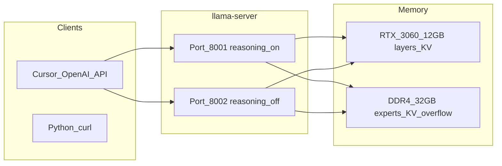

# Чек-лист: Qwen3.6 на i7-14700KF + 32GB + RTX 3060 12GB (llama.cpp)

## Реалистичная цель железа


| Модель Qwen3.6                 | На вашей конфигурации                                                                                                                                                                      |
| ------------------------------ | ------------------------------------------------------------------------------------------------------------------------------------------------------------------------------------------ |
| **35B-A3B (MoE, официальная)** | **Основной выбор**: ~3B активных параметров на токен; веса Q4 ~23 GB *суммарной* памяти (RAM+VRAM), у вас **12 GB VRAM + ~24–28 GB свободной RAM** — помещается при гибриде и `n-cpu-moe`. |
| **27B (dense)**                | Q4 ~**19 GB только на 4K контекста** — **не влезает целиком в 12 GB VRAM**; полный GPU-only невозможен, offload даст ~3–8 tok/s — **не «комфорт»**.                                        |
| **NVFP4**                      | Только Blackwell (RTX 50xx) — **не для 3060**.                                                                                                                                             |


**Вывод:** для «больших рассуждений + траблшутинг + разработка» на **именно Qwen3.6** ставим `**unsloth/Qwen3.6-35B-A3B-GGUF:UD-Q4_K_XL`** (+ `**mmproj-F16**` для vision). Если не хватает VRAM под vision + длинный контекст — запасной квант `**UD-Q3_K_XL**` или `**UD-IQ4_NL_XL**` (меньше вес, больше места под KV).

Ожидаемый UX (ориентир, не гарантия): **~8–18 tok/s** decode при частичном offload экспертов на CPU; prompt processing быстрее. Thinking-режим «ест» **сотни–тысячи скрытых токенов** до ответа — это нормально, не путать с зависанием.




---

## Важно про RAM и «два сервера»

На **32 GB DDR4** один экземпляр Qwen3.6-35B-A3B (Q4 + KV + runtime) занимает **~23–28 GB RAM+VRAM** в гибриде. **Два `llama-server` одновременно** почти наверняка **не влезут** — будет swap и «слайд-шоу».

**Практичная схема для вашего ПК:**

- **По умолчанию:** один сервер; переключение режима = **остановить процесс** и запустить другой `.ps1` (`--reasoning on` vs `off`).
- **Два порта параллельно** — только если в Диспетчере задач после одного сервера остаётся **&gt; 14 GB свободной RAM** и второй стартует без swap; иначе не использовать.

---

## Фаза 0 — Подготовка системы (Windows), пошагово

### 0.1 Структура каталогов (сделать один раз)

```powershell
New-Item -ItemType Directory -Force -Path "D:\AI\llama.cpp", "D:\Models\llama", "D:\AI\scripts"
```

`C:` вместо `D:` — ок, главное **SSD** и **~30 GB** свободно.

### 0.2 Драйвер NVIDIA

1. [nvidia.com/drivers](https://www.nvidia.com/drivers) → RTX 3060 → Windows 11/10 → скачать **Game Ready** или **Studio**.
2. Установка → перезагрузка.
3. Проверка в **PowerShell**:

```powershell
nvidia-smi
```

Ожидаете: таблица с **RTX 3060**, **12288 MiB**, Driver Version. Если «не recognized» — переустановить драйвер.

### 0.3 CUDA Toolkit (для сборки, не путать с драйвером)

1. [developer.nvidia.com/cuda-downloads](https://developer.nvidia.com/cuda-downloads) → Windows → x86_64 → exe (local).
2. Версия: **CUDA 12.6** или **12.4** (стабильно с llama.cpp). **Не ставить 13.2** как единственную, если Unsloth предупреждает о gibberish — для runtime inference достаточно драйвера; Toolkit нужен **только для компиляции**.
3. После установки:

```powershell
nvcc --version
```

Должна показаться версия 12.x. Если команда не найдена — добавить в PATH (типично):  
`C:\Program Files\NVIDIA GPU Computing Toolkit\CUDA\v12.6\bin`

### 0.4 Visual Studio 2022 (компилятор C++)

1. Скачать **Visual Studio 2022 Community** (бесплатно).
2. В установщике отметить workload: **«Разработка классических приложений на C++»** / *Desktop development with C++*.
3. Справа в компонентах убедиться: **MSVC v143**, **Windows 10/11 SDK**, **C++ CMake tools for Windows**.
4. (Опционально) **Ninja** — через VS Installer → Individual components → Ninja.

Сборку llama.cpp удобнее запускать из **«x64 Native Tools Command Prompt for VS 2022»** (Пуск → Visual Studio 2022) — там уже настроены `cl.exe` и окружение.

### 0.5 Git и Python

```powershell
winget install --id Git.Git -e
winget install --id Python.Python.3.12 -e
```

Закрыть и открыть PowerShell, затем:

```powershell
python --version
git --version
```

### 0.6 Файл подкачки (обязательно)

1. **Win + R** → `sysdm.cpl` → вкладка **Дополнительно** → **Быстродействие** → **Параметры** → **Дополнительно** → **Виртуальная память** → **Изменить**.
2. Снять «Автоматически» → выбрать **SSD-диск** (тот же, где модели).
3. **Указать размер:** начальный **49152**, максимальный **65536** (MB) → **Задать** → OK → перезагрузка.

Проверка после reboot:

```powershell
Get-CimInstance Win32_PageFileUsage | Select Name, AllocatedBaseSize, CurrentUsage
```

### 0.7 Базовая «гигиена» перед inference

- Закрыть Chrome/Edge с тяжёлыми вкладками, игры, OBS NVENC.
- **Диспетчер задач** → Производительность → Память: целиться в **≥ 20 GB свободно** перед стартом сервера.
- Для мониторинга VRAM в отдельном окне:

```powershell
nvidia-smi -l 2
```

---

## Фаза 1 — Сборка llama.cpp (CUDA, Release), пошагово

### 1.1 Клонирование

В **x64 Native Tools Command Prompt for VS 2022**:

```cmd
cd /d D:\AI
git clone https://github.com/ggml-org/llama.cpp
cd llama.cpp
git pull
```

Если нужна стабильность — можно `git checkout master` после pull (Qwen3.6 / MoE / `--reasoning` только в свежих коммитах).

### 1.2 CMake: архитектура под RTX 3060 (Ampere sm_86)

RTX 3060 = **compute capability 8.6**. Явно задать, чтобы не собирать лишнее:

```cmd
cmake -B build ^
  -DBUILD_SHARED_LIBS=OFF ^
  -DGGML_CUDA=ON ^
  -DCMAKE_BUILD_TYPE=Release ^
  -DCMAKE_CUDA_ARCHITECTURES=86
```

Если CMake не видит CUDA:

```cmd
set CUDA_PATH=C:\Program Files\NVIDIA GPU Computing Toolkit\CUDA\v12.6
cmake -B build ... (те же флаги)
```

### 1.3 Сборка бинарников

```cmd
cmake --build build --config Release -j %NUMBER_OF_PROCESSORS% ^
  --target llama-server llama-cli llama-mtmd-cli
```

Первая сборка **10–30 мин**. Успех: файлы существуют:

```cmd
dir build\bin\Release\llama-server.exe
```

### 1.4 Проверка CUDA в бинарнике

```cmd
build\bin\Release\llama-server.exe --version
```

В выводе должны быть упоминания **CUDA** / GPU backend. Запуск без аргументов не должен падать с «DLL not found» — если падает, установить [VC++ Redistributable x64](https://aka.ms/vs/17/release/vc_redist.x64.exe).

### 1.5 Альтернатива, если сборка ломается

- Скачать **pre-release** с [Releases llama.cpp](https://github.com/ggerganov/llama.cpp/releases) (бинарники `llama-bXXXX-cuda-...-win.zip`) — положить рядом с `D:\AI\scripts` и в скриптах заменить путь на `llama-server.exe` из zip.
- Или сборка через **WSL2 + CUDA** — дольше по настройке; на чистом Windows обычно хватает Native Tools.

### 1.6 PATH (опционально)

```powershell
[Environment]::SetEnvironmentVariable(
  "Path",
  $env:Path + ";D:\AI\llama.cpp\build\bin\Release",
  "User"
)
```

---

## Фаза 2 — Загрузка модели и vision, пошагово

### 2.1 Python-инструменты Hugging Face

```powershell
python -m pip install -U pip
python -m pip install -U "huggingface_hub[cli]" hf-transfer
$env:HF_HUB_ENABLE_HF_TRANSFER = "1"
```

Если репозиторий gated или rate limit — один раз:

```powershell
huggingface-cli login
```

(Vставить token с [huggingface.co/settings/tokens](https://huggingface.co/settings/tokens), read достаточно.)

### 2.2 Постоянные переменные окружения (рекомендуется)

```powershell
[Environment]::SetEnvironmentVariable("LLAMA_CACHE", "D:\Models\llama", "User")
[Environment]::SetEnvironmentVariable("HF_HUB_ENABLE_HF_TRANSFER", "1", "User")
```

Новое окно PowerShell → `$env:LLAMA_CACHE` должно показать путь.

### 2.3 Скачивание весов + mmproj

```powershell
$dest = "$env:LLAMA_CACHE\unsloth\Qwen3.6-35B-A3B-GGUF"
hf download unsloth/Qwen3.6-35B-A3B-GGUF `
  --local-dir $dest `
  --include "*UD-Q4_K_XL*" `
  --include "*mmproj*"
```

Скачивание **~18–22 GB**, время зависит от канала. Можно прервать и повторить — докачка resume.

### 2.4 Проверка, что файлы на месте

```powershell
Get-ChildItem $dest -Recurse -Include *.gguf | Select-Object Name, @{N='GB';E={[math]::Round($_.Length/1GB,2)}}
```

Минимум:

- один файл вида `*UD-Q4_K_XL*.gguf` (**~16–20 GB** на диске);
- `*mmproj*.gguf` (**~0.9 GB**).

Запомните **полные пути** — при ручном запуске без `-hf` они понадобятся.

### 2.4.1 Если OOM уже на этапе планирования

Параллельно скачать запасной квант (не удаляя Q4):

```powershell
hf download unsloth/Qwen3.6-35B-A3B-GGUF --local-dir $dest --include "*UD-Q3_K_XL*"
```

### 2.5 Как работает `-hf` у llama-server

Флаг `-hf unsloth/Qwen3.6-35B-A3B-GGUF:UD-Q4_K_XL` заставляет сервер **найти или скачать** нужный файл в кэш (`LLAMA_CACHE` или `%USERPROFILE%\.cache\llama.cpp`). После фазы 2.3 локальная копия уже есть — старт будет быстрее.

---


## Фаза 3 — Конфиг под 12 GB + vision, пошагово

Ключевая идея (как в [разборе MoE + llama.cpp](https://dzx.fr/blog/local-ai-coding/)): **все постоянно активные слои на GPU**, **часть MoE-экспертов на CPU** (`n-cpu-moe`), **KV при нехватке VRAM — в RAM** (`cache-ram`, `kv-unified`), **mmproj не грузить на GPU** если тесно (`no-mmproj-offload`).

### 3.0 Что делают ключевые параметры

| Параметр | Зачем |
| -------- | ----- |
| `n-gpu-layers 99` | «Все слои на GPU, сколько влезет»; для MoE часть экспертов уйдёт на CPU через `n-cpu-moe`. |
| `n-cpu-moe N` | **N** слоёв MoE держать экспертов в **RAM/CPU**; меньше VRAM, больше нагрузка на i7-14700KF. |
| `cache-ram 8192` | До **8 GB** KV-кэша в **оперативке**, если не влезает в VRAM. |
| `kv-unified true` | Единый пул KV — проще на одном пользователе (`parallel 1`). |
| `no-mmap true` | На Windows часто стабильнее для больших GGUF. |
| `no-mmproj-offload true` | Vision-проектор **не на GPU** — экономия VRAM, картинки чуть медленнее. |
| `ctx-size 32768` | Окно контекста; больше = больше RAM и медленнее decode. |
| `parallel 1` | Один inference-запрос одновременно — **обязательно** на 32 GB при 35B. |
| `--reasoning on/off` | Hybrid thinking **на старте сервера**; смена режима = перезапуск процесса. |

### 3.1 Файл `models.ini`

Путь (Windows): `%USERPROFILE%\.config\llama.cpp\models.ini`

```ini
[*]
cache-ram = 8192
kv-unified = true
no-mmap = true
sleep-idle-seconds = 600

[unsloth/Qwen3.6-35B-A3B-GGUF:UD-Q4_K_XL]
alias = qwen3.6-35b-a3b
hf-repo = unsloth/Qwen3.6-35B-A3B-GGUF:UD-Q4_K_XL
ctx-size = 32768
ctx-checkpoints = 2
n-gpu-layers = 99
n-cpu-moe = 22
no-mmproj-offload = true
ubatch-size = 512
parallel = 1
```

Создание файла в PowerShell:

```powershell
$configDir = "$env:USERPROFILE\.config\llama.cpp"
New-Item -ItemType Directory -Force -Path $configDir
notepad "$configDir\models.ini"
```

### 3.2 Файл `D:\AI\scripts\Qwen-Common.ps1`

```powershell
$LLAMA_ROOT = "D:\AI\llama.cpp"
$script:SERVER = "$LLAMA_ROOT\build\bin\Release\llama-server.exe"
$env:LLAMA_CACHE = "D:\Models\llama"

$MODEL_DIR  = "$env:LLAMA_CACHE\unsloth\Qwen3.6-35B-A3B-GGUF"
$MODEL_GGUF = (Get-ChildItem $MODEL_DIR -Filter "*UD-Q4_K_XL*.gguf" | Select-Object -First 1).FullName
$MMPROJ     = (Get-ChildItem $MODEL_DIR -Filter "*mmproj*.gguf" | Select-Object -First 1).FullName

if (-not $MODEL_GGUF) { throw "GGUF not found in $MODEL_DIR" }
if (-not $MMPROJ)     { throw "mmproj not found in $MODEL_DIR" }

$script:COMMON = @(
  "--model", $MODEL_GGUF,
  "--mmproj", $MMPROJ,
  "--host", "127.0.0.1",
  "--ctx-size", "32768",
  "--n-gpu-layers", "99",
  "--n-cpu-moe", "22",
  "--cache-ram", "8192",
  "--parallel", "1",
  "--no-mmproj-offload"
)
```

### 3.3 Два режима = два скрипта (один процесс за раз на 32 GB)

Современный llama.cpp: **`--reasoning on/off`** только при старте. **Не держите оба сервера параллельно** на 32 GB RAM — см. раздел «Важно про RAM».


| Профиль       | Порт | Флаг              | Задачи                                        |
| ------------- | ---- | ----------------- | --------------------------------------------- |
| **DeepThink** | 8001 | `--reasoning on`  | траблшутинг, архитектура, длинные рассуждения |
| **DevFast**   | 8002 | `--reasoning off` | код, рефакторинг, быстрые итерации            |


**Start-Qwen-Think.ps1** — sampling по [Unsloth Qwen3.6](https://unsloth.ai/docs/models/qwen3.6):

```powershell
. "$PSScriptRoot\Qwen-Common.ps1"
& $SERVER @COMMON `
  --port 8001 `
  --alias "qwen3.6-35b-a3b-think" `
  --reasoning on `
  --temp 1.0 --top-p 0.95 --top-k 20 --min-p 0.0 `
  --presence-penalty 0.0 `
  --chat-template-kwargs '{\"preserve_thinking\":true}'
```

Для **точного кода / WebDev** в thinking: `--temp 0.6` (остальное как выше).

**Start-Qwen-Code.ps1:**

```powershell
. "$PSScriptRoot\Qwen-Common.ps1"
& $SERVER @COMMON `
  --port 8002 `
  --alias "qwen3.6-35b-a3b-instruct" `
  --reasoning off `
  --temp 0.7 --top-p 0.8 --top-k 20 --min-p 0.0 `
  --presence-penalty 1.5
```

```powershell
Set-ExecutionPolicy -Scope CurrentUser RemoteSigned
D:\AI\scripts\Start-Qwen-Code.ps1
```

Окно не закрывать; **Ctrl+C** — остановка. Альтернатива: `-hf unsloth/Qwen3.6-35B-A3B-GGUF:UD-Q4_K_XL` + явные `--n-cpu-moe`, `--ctx-size`, `--mmproj`.

При gibberish добавьте в `@COMMON`: `--cache-type-k bf16 --cache-type-v bf16`.

### 3.4 Первый запуск и тюнинг

1. Запустить скрипт → в консоли **HTTP server listening**.
2. `nvidia-smi`: VRAM **10–11.5 GB** — норма; **CUDA OOM** → ↑ `n-cpu-moe` (22→26→30) или Q3.
3. VRAM &lt; 9 GB и CPU 100% → ↓ `n-cpu-moe` на 2–4.

### 3.5 Контекст и лимиты генерации

- [ ] `**ctx-size**`: старт **32768**; если стабильно по RAM — **65536** (рост KV; на 12 GB часть уйдёт в `cache-ram`).
- [ ] `**max_tokens` / `-n` в клиенте**: для thinking — **8192–32768** на ответ (Unsloth: «adequate output ~32768» для сложных запросов).
- [ ] **Preserve thinking**: `preserve_thinking: true` улучшает многоходовые диалоги, но **раздувает контекст** — для длинных сессий периодически **сжимать историю** или новый чат.
- [ ] **Vision**: в API/OpenAI-compatible — multimodal content (image_url / base64); локально проверить через `llama-mtmd-cli` с тем же `--mmproj`.

### 3.6 Профили задач


| Сценарий                     | Сервер                 | Промпт-диета                                                                         |
| ---------------------------- | ---------------------- | ------------------------------------------------------------------------------------ |
| RCA / логи / «почему падает» | 8001 thinking          | Вложить стек-трейс, версии, шаги воспроизведения; попросить гипотезы → проверки      |
| Code review / фича           | 8002 instruct          | Конкретные файлы, ограничения; thinking off = быстрее                                |
| Агент с tool calls           | 8002 или 8001          | `parallel_tool_calls` осторожно — иногда ломает мелкие модели; для 35B-A3B обычно ок |
| Скрин UI / диаграмма         | 8001 или 8002 + mmproj | Уменьшить разрешение картинки до ~1024px стороны                                     |


---

## Фаза 4 — Проверка работоспособности, пошагово

### 4.1 Сервер отвечает

```powershell
Invoke-RestMethod -Uri "http://127.0.0.1:8001/v1/models"
```

В JSON — `"id"` = ваш `--alias`.

### 4.2 Тест thinking (Invoke-RestMethod)

```powershell
$body = @{
  model = "qwen3.6-35b-a3b-think"
  messages = @(@{ role = "user"; content = "17*23=? Сначала рассуждай, потом одно число." })
  max_tokens = 2048
} | ConvertTo-Json -Depth 5

Invoke-RestMethod -Uri "http://127.0.0.1:8001/v1/chat/completions" `
  -Method Post -ContentType "application/json; charset=utf-8" -Body $body
```

Успех: **391** и/или `reasoning_content`. Пустой ответ — ↑ `max_tokens`.

### 4.3 Code на :8002

Start-Qwen-Code.ps1, тот же запрос с `model = "qwen3.6-35b-a3b-instruct"`.

### 4.4 Vision: llama-mtmd-cli

```powershell
$CLI = "D:\AI\llama.cpp\build\bin\Release\llama-mtmd-cli.exe"
$dir = "D:\Models\llama\unsloth\Qwen3.6-35B-A3B-GGUF"
& $CLI --model (Get-ChildItem $dir -Filter "*UD-Q4_K_XL*.gguf").FullName `
  --mmproj (Get-ChildItem $dir -Filter "*mmproj*.gguf").FullName `
  --image "D:\path\screenshot.png" -p "Опиши UI." --n-gpu-layers 99 --n-cpu-moe 22 -n 512
```

### 4.5 Vision: HTTP + base64

Сформировать `data:image/png;base64,...` (см. `[Convert]::ToBase64String([IO.File]::ReadAllBytes(...))`) в `image_url` внутри `content` массива сообщения.

### 4.6 Stress

~12 KB лога + thinking; при swap — ↓ `ctx-size` или без `preserve_thinking`.

---

## Фаза 5 — Cursor, пошагово

1. **Start-Qwen-Code.ps1** → порт **8002**.
2. Cursor **Settings** (Ctrl+,) → **Models**.
3. API Key: `sk-local`.
4. **Override OpenAI Base URL:** `http://127.0.0.1:8002/v1`.
5. Custom model: `qwen3.6-35b-a3b-instruct` (как в `/v1/models`).
6. Тест в Chat. Ошибка сети → Firewall для `llama-server.exe`.
7. DeepThink: перезапуск **Think** на **8001**, URL `http://127.0.0.1:8001/v1`, модель `qwen3.6-35b-a3b-think`.

```python
# pip install openai
from openai import OpenAI
client = OpenAI(base_url="http://127.0.0.1:8001/v1", api_key="sk-local")
r = client.chat.completions.create(
    model="qwen3.6-35b-a3b-think",
    messages=[{"role": "user", "content": "..."}],
    max_tokens=8192,
)
print(getattr(r.choices[0].message, "reasoning_content", None))
print(r.choices[0].message.content)
```

---

## Фаза 6 — Траблшутинг

| Симптом | Проверка | Действие |
| ------- | -------- | -------- |
| OOM CUDA | лог, `nvidia-smi` | ↑ `n-cpu-moe`, Q3, `parallel 1` |
| OOM RAM | Task Manager | ↓ `ctx-size`, один сервер |
| Gibberish | короткий prompt | ctx 32768, bf16 KV, свежий llama.cpp |
| Медленно | CPU 100% | ↓ `n-cpu-moe`, Code reasoning off |
| Порт занят | `netstat -ano \| findstr 8001` | другой порт / kill PID |
| model not found | `/v1/models` | alias = имя в Cursor |
| Vision | mtmd-cli | mmproj, `no-mmproj-offload` |

---

## Фаза 7 — Опционально

- **MTP** + `MTP-GGUF`, `--spec-draft-n-max 2` (+~1 GB VRAM).
- **Task Scheduler:** logon → `Start-Qwen-Code.ps1`.
- **Бенчмарк tok/s** до/после `n-cpu-moe`.

---

## Чего не ждать на этом железе

- Полный **Qwen3.6-27B** на GPU в Q4 — **нет**; только деградированные кванты или сильный offload.
- **128K+ контекст** в Q4 на 12 GB — нереалистично; целиться в **32K–64K** с RAM offload.
- Скорость cloud-моделей; локально вы выигрываете **приватность, длинный thinking, отсутствие лимитов API**.

---

## Источники параметров

- Рекомендуемые sampling и thinking/instruct: [Unsloth Qwen3.6 docs](https://unsloth.ai/docs/models/qwen3.6)
- MoE offload / `models.ini`: [Local AI coding with llama.cpp](https://dzx.fr/blog/local-ai-coding/)
- VRAM оценки 27B/35B: [quantized.uk Qwen3.6 27B](https://quantized.uk/quant-hub/qwen3-6-27b/), Unsloth memory tables


